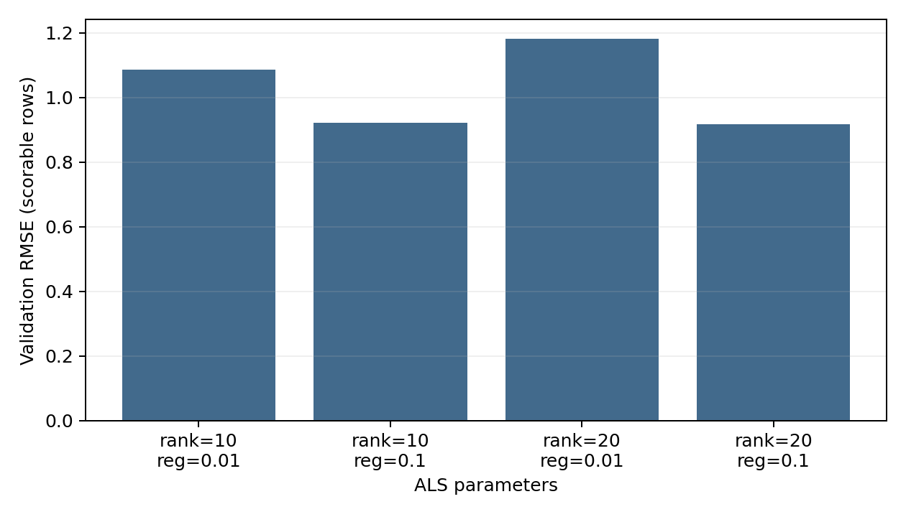

# MovieLens recommendations with Spark ALS

A local recommendation demo using MovieLens 100K, Spark's explicit-feedback alternating least squares (ALS), and Flask.

Training selects parameters on validation ratings and evaluates the chosen model on a held-out test split. The CLI and API share a recommendation engine that excludes movies the user has already rated.

## Data and evaluation

The included [MovieLens 100K dataset](https://grouplens.org/datasets/movielens/100k/) has 100,000 ratings, 943 users and 1,682 movies. See the [GroupLens dataset documentation and terms](https://files.grouplens.org/datasets/movielens/ml-100k-README.txt).

- `u.data`: tab-separated user ID, movie ID, rating and timestamp.
- `u.item`: pipe-separated movie metadata and 19 genre flags; decoded as Latin-1.
- `u.genre`: genre names and their indices.
- `u.user`: additional user metadata; not used by ALS.

The default run uses a seeded random **80/10/10 rating split**. It compares ranks 10 and 20 and regularization values 0.01 and 0.1, with 10 ALS iterations. The lowest validation RMSE selects the model; the test split is scored once afterwards.

`metrics.json` records the data hashes, Spark version, split sizes, parameter grid and test results. Metrics include:

- RMSE and MAE on ratings ALS can score.
- Scored and unscored row counts, plus prediction coverage.
- A training-set mean-rating baseline, evaluated on the same rows as ALS and on all test rows.

ALS cannot score users or movies without learned factors. Those rows are counted explicitly. Random splitting evaluates held-out rating prediction; temporal generalization and recommendation ranking quality remain unmeasured.

## Verified run

The default four-candidate grid was run on the included data with Spark 4.0.1, Python 3.12 and Java 17. Validation selected rank 20 and regularization 0.1, with 10 iterations.



| Held-out test result | Value |
| --- | ---: |
| ALS RMSE on scorable rows | 0.9164 |
| Mean-rating baseline RMSE on the same rows | 1.1188 |
| ALS MAE on scorable rows | 0.7250 |
| Prediction coverage | 99.79% |

ALS scored 9,895 of 9,916 test ratings; 21 had no usable factors. The complete run, including validation results and data hashes, is saved in [examples/verified_metrics.json](examples/verified_metrics.json). These figures describe this dataset and random split.

## Run

Use Python 3.10+ and Java 17+ (`java -version`). Spark runs locally on two threads.

```bash
python -m venv .venv
source .venv/bin/activate
pip install -r requirements.txt
python train.py
```

The default run saves the model to `models/als_run/model` and its report to `models/als_run/metrics.json`. Training requires a new or empty output directory.

### Recommend movies

```bash
python inference.py --user_id 1 --top_n 10
python inference.py --user_id 1 --top_n 10 --output models/recommendations.json
```

Results include movie IDs, titles, genres and predicted ratings. Already-rated movies are excluded using the supplied ratings file. ALS scores are unconstrained and can fall outside the 1–5 rating range.

For another run, pass the same model directory to inference and the API:

```bash
python inference.py --model_path models/another_run/model --user_id 1
```

### Local API

```bash
python api.py --model_path models/als_run/model --host 127.0.0.1 --port 5000
curl "http://127.0.0.1:5000/recommend?user_id=1&top_n=10"
```

`GET /health` reports readiness. Invalid arguments return HTTP 400; a user absent from the learned factors returns HTTP 404. `top_n` must be between 1 and 100.

### Plot and test

```bash
python visualize.py --metrics models/als_run/metrics.json --output models/validation_rmse.png
python -m unittest discover -s tests -v
MOVIELENS_TEST_MODEL=models/als_run/model python -m unittest discover -s tests -v
```

The first test command checks data parsing and API argument handling. The second also loads the trained model, checks that recommendations exclude rated movies, and exercises Flask endpoints with the real model.

This is a local demonstration. Model training, source-data validation, recommendation scoring and HTTP routing are separate so each step can be checked independently.
